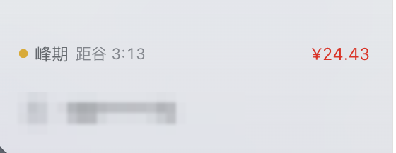
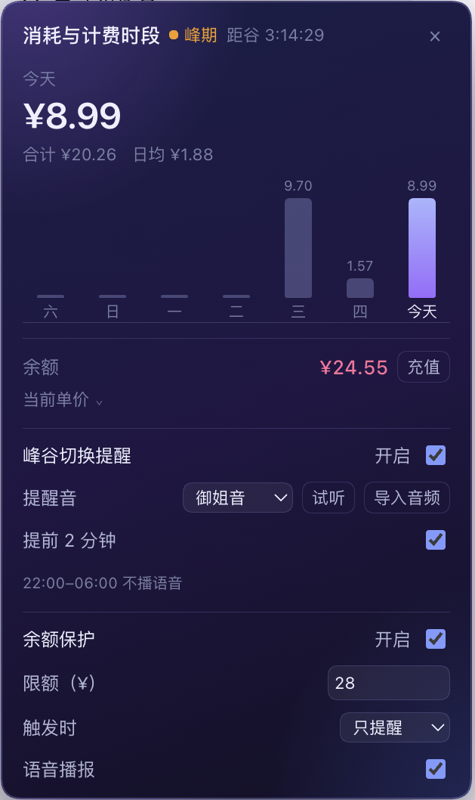
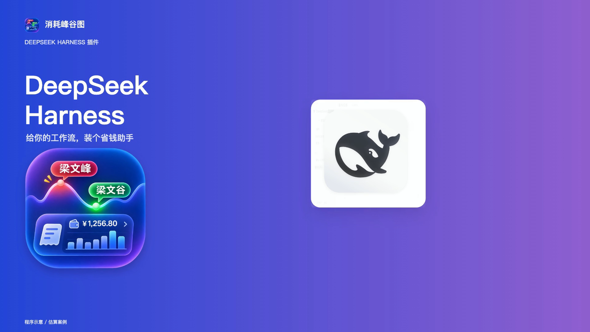

<p align="center">
  
</p>

<h1 align="center">Spend peak/off-peak chart · dsh-spend-trend</h1>

<p align="center"><b>Think during peak, do the heavy lifting off-peak — so every cent buys real work.</b></p>

<p align="center">
  <a href="README.md">中文</a> ·
  <a href="https://www.npmjs.com/package/@apecube/dsh-spend-trend"></a>
  
</p>

## Why install it

- 💰 **Shifting work off-peak is the point**: the same generation costs half as much off-peak — output ¥8 → ¥4 per million tokens, cache hit ¥0.04 → ¥0.02. The badge turns “is it expensive right now, and how long until it isn't” into one line you can always see.
- ⏰ **The alarm exists to catch the cheap window**: when off-peak starts, a voice tells you to get going — that is the slot for long runs, batch generation and refactors, while peak is for lighter work (requirements, prompts, copy edits, review). Whether the voice is pleasant does not matter; **not doing heavy work at peak prices does**.
- 📊 **The bill at a glance**: account balance, today's spend, a 7-day bar chart and the current model's two-tier rates, one click away.
- 🪶 **Small and local**: plain JavaScript, no runtime dependencies, no outbound network — it only reads token usage from your local session logs.
- 🪟 **One row, no clutter**: fits a 13-inch screen; collapse the sidebar and only a dot and an amount remain, taking no working space.

## Install

**In DSH Desktop**: open **Plugins → Add plugin**, enter

```
@apecube/dsh-spend-trend
```

then **Install**, **Enable now**, and refresh the page. The same path works on Windows.

You can also just tell DSH:

> Install the @apecube/dsh-spend-trend plugin for me.

It installs and enables the plugin itself.

To remove it, use the **Plugins** page.

## Screenshots





## Video

[](https://www.bilibili.com/video/BV1vYWa6VE6X)

A 30-second walkthrough: it calls you when off-peak starts, and shows what is left before peak. [Watch on Bilibili](https://www.bilibili.com/video/BV1vYWa6VE6X)

## How to use it: the off-peak rhythm

| Window | Do this | Why |
|---|---|---|
| **Peak** (weekdays 09:00–12:00, 14:00–18:00) | Requirements, prompts, reading plans, copy edits, code review | Many turns, few tokens — the premium barely matters |
| **Off-peak** (all other hours + weekends) | Long runs, batch generation, refactors, long documents, multi-turn agents | Half the unit price, twice the work for the same budget |
| **Before bed** | Queue heavy jobs after midnight | The whole night is off-peak |

In one line: **think when it is expensive, work when it is cheap.**

## What it shows

One badge at the bottom of the sidebar, directly above the account entry:

- **Current billing phase**: `● Peak` / `● Off-peak`, followed by the countdown to the next switch, with the **account balance** on the right.
- Click it for a **7-day CNY spend bar chart**, the current model's rates, today's spend, total and daily average, the balance breakdown, and the peak/off-peak schedule.

## Phase alarm

The popover can notify you when the billing phase flips (off by default):

| Setting | Meaning |
|---|---|
| Enable | Master switch; asks for notification permission on first use and falls back to sound only when denied |
| Sound | Mature voice / Cute voice / Stop slacking / Ping / Chime / Bell / Silent, with a preview button; clips dropped into `~/.dsh/spend-trend-sounds/` appear here too |
| 2-minute heads-up | Off by default; plays a light chime two minutes before the switch |

Rules: entering **off-peak** plays the selected voice, entering **peak** always uses Ping, and between **22:00 and 06:00 Beijing time** the voice is replaced by Ping. Settings live in browser `localStorage` (per device). The page must stay open for the alarm to fire; a sleeping machine stays silent and catches up once on wake.

## Balance guard

It exists for one scenario: a session left running while you walk away, draining the account. When the balance drops below your threshold, the plugin steps in.

The panel's **Balance guard** section has three settings:

| Setting | Meaning |
|---|---|
| Enable | Off by default |
| Threshold | Default **¥5**; triggers below this |
| When triggered | **Warn only** (default) or **Pause work** |
| Voice alert | On by default; turn it off to keep only the flash and notification |

A **Top up** button sits next to the balance and opens the official recharge page.

**Warn only**: the badge turns amber, a banner appears at the top of the panel, a voice clip says the balance is low, and one system notification fires at the moment the balance crosses the line (between 22:00 and 06:00 the voice becomes a short tone).

**Pause work**: besides the warning, every tool call is refused while the balance is below the threshold (`ask_user_question` stays available), so the agent cannot make progress and the session stops. The tool result names the balance, the threshold and how to resume, so the model stops and asks instead of retrying.

After topping up the balance refreshes on its own — when the top-up page closes, when the window regains focus, or on the once-a-minute poll — and work resumes automatically once it is back above the threshold.

> This is a last-resort brake, not a budget. It only intervenes when the account is running out; per-task caps belong in plugins such as `dsh-task-budget`.
>
> Safety: the page reports the balance every 60 seconds even when the value is unchanged, and the host treats a report older than **10 minutes** as unknown and stops blocking — closing the page can never lock a session for good.

## Custom alarm sounds

The two bundled voices may not suit everyone — no command line needed:

1. Open the panel → enable the alarm → click **Import audio**;
2. Pick an **mp3 / m4a / wav / ogg** file (≤ 4 MB);
3. It is selected automatically; hit **Preview** to confirm.

Clips are stored in `$DSH_HOME/spend-trend-sounds/` (defaults to `~/.dsh/spend-trend-sounds/`); you can also copy files there by hand. The file name becomes the option label, a duplicate gets a `-2` suffix, the list re-scans whenever the panel opens, and deleting a file falls back to the default voice.

## FAQ

**No alarm sound?**
Desktop builds usually need no extra step; if you truly hear nothing, click anywhere in the page once (browsers suspend audio until the page has seen an interaction). Then check that **Enable** is on and the sound is not **Silent**. If the badge flashes and a notification appears but you hear nothing, the trigger worked and only the sound was blocked; it replays on your next click.

**An imported clip does not play?**
Make sure it is mp3 / m4a / wav / ogg and under 4 MB, then select it under **Sound** and hit **Preview**. Re-import a different file if it still fails — broken files are rejected instead of being stored silently.

**Balance shows “—”?**
The account call returned nothing, usually because you are signed out or the login expired. Sign in again under Settings → Account.

**Numbers differ from the platform bill?**
They are estimates priced at the tier of each call; platform bills can include discounts and granted-credit offsets. The higher your cache-hit rate, the more the peak/off-peak gap sits in the cache-hit rate (¥0.04 vs ¥0.02).

**Nothing shows up on Windows?**
Check that the plugin is **Enabled** on the Plugins page, then restart the app once — the client bundle only loads on a fresh page.

**Will it wake me at night?**
No. The voice only plays when off-peak starts, and phase switches only happen at 09:00, 12:00, 14:00 and 18:00 Beijing time; between 22:00 and 06:00 the voice is replaced by a tone.

## Billing model

DeepSeek has charged peak/off-peak time-of-day rates since 2026-08-17. Every call is priced at the tier in effect **when that call actually happened** — not per day, and not at the current instant:

| Model | Cache hit (off-peak/peak) | Cache miss (off-peak/peak) | Output (off-peak/peak) |
|---|---|---|---|
| deepseek-flash | ¥0.02 / ¥0.04 | ¥1 / ¥2 | ¥4 / ¥8 |
| deepseek-v4-pro | ¥0.15 / ¥0.30 | ¥4.5 / ¥9 | ¥13.5 / ¥27 |

Unit: CNY per million tokens ([official price list](https://api-docs.deepseek.com/quick_start/pricing/)).

- Peak: **Beijing time, Monday to Friday, 09:00–12:00 and 14:00–18:00**; every other hour, plus all weekend hours, bills off-peak.
- Cost = uncached input × miss rate + (cache read + cache write) × hit rate + output × output rate, using the tier of that usage's own timestamp.
- Unknown models fall back to the deepseek-flash rates.
- **Chinese statutory holidays** are not built in; configure them through `$DSH_HOME/spend-trend-holidays.json` (see below).

### What one refactor costs

Take a medium refactor of **100 rounds**, 120k input tokens per round (100k cache hits, 20k misses) and 4k output tokens, on `deepseek-flash`:

| Item | Per round (peak) | Per round (off-peak) |
|---|---|---|
| 20k misses × rate | 20k × ¥2/M = ¥0.040 | 20k × ¥1/M = ¥0.020 |
| 100k hits × rate | 100k × ¥0.04/M = ¥0.004 | 100k × ¥0.02/M = ¥0.002 |
| 4k output × rate | 4k × ¥8/M = ¥0.032 | 4k × ¥4/M = ¥0.016 |
| **Total** | **¥0.076** | **¥0.038** |

The whole task: **¥7.60 at peak vs ¥3.80 off-peak**. Run it 20 times a month and that is **¥152 vs ¥76** — the saving alone pays for twenty more refactors.

> Estimates follow the official price list and the token mix above. The real bill depends on the cache-hit rate: the higher it is, the more the peak/off-peak gap sits in the cache-hit rate (¥0.04 vs ¥0.02).

## Platform support

Works on macOS, Windows and Linux: the plugin is plain JavaScript, the host half only uses cross-platform Node APIs (`fs`, `os`, `path`), and the browser half is an ordinary web component — no shell commands, native dependencies or platform checks. CI runs the suite on Ubuntu, Windows and macOS across Node 20/22/24.

## Statutory holidays

Under the official rules, Chinese statutory holidays bill off-peak all day. No holiday calendar is bundled by default (holiday shifts and repricing both change over time), so drop a file in place to keep the classification accurate:

```sh
# Path: $DSH_HOME/spend-trend-holidays.json (defaults to ~/.dsh/spend-trend-holidays.json)
["2026-10-01", "2026-10-02", "2026-10-03"]
```

A missing or malformed file means “no holidays”; it never blocks startup.

## Data sources

- **Spend**: the host reads the persisted session logs, takes the model-reported `usage` from `assistant/message`, prices each event at its own tier, and folds the result into 15-minute buckets over a 7-day window.
- **Balance**: reuses the account plugin's `account.getBalance` remote call (topped-up plus granted balance).
- **Voices**: the two clips in `assets/sounds/` are served by a read-only host route and played locally; nothing is uploaded.

## Refresh model

| Content | Mechanism | Frequency |
|---|---|---|
| Spend and current tier | Polls `GET /plugin/dsh-spend-trend/daily` | Every 60 seconds |
| Balance | Remote `account.getBalance` | Every 180 seconds |
| Countdown | Local timer only | Every second, no request |

A backgrounded page makes no extra requests and refreshes once when it becomes visible again. When the countdown reaches zero (a tier switch), the plugin refetches immediately instead of waiting for the next 60-second poll.

## Files

| File | Role |
|---|---|
| `index.js` | Plugin entry: route wiring, holiday-file loading, voice routes |
| `lib/pricing.js` | Rate table, peak/off-peak schedule, per-call pricing |
| `lib/usage.js` | Session-log aggregation |
| `client.js` | Browser half: the badge, popover and alarm settings in the `sidebar.footer.action` slot |
| `cordis.patch.yml` | Inserts the `spend-trend` plugin row |
| `locale/*.json` | Title and description shown by the plugin manager |
| `icon.svg` | Plugin-list icon (vector) |
| `assets/icon-180.png` | 180×180 raster tile for the plugin market card |
| `assets/icon-source.png` | Original icon artwork (1254×1254, not shipped in the npm package) |
| `assets/screenshots/*.png` | Market detail-page screenshots and the video poster |
| `assets/sounds/*.m4a` | Alarm voices (mature / cute / stop slacking / balance warning) |
| `screenshots.json` | Declares the screenshot order the market shows |

## Development

```sh
node --test test/     # 17 cases: phase boundaries, weekends/holidays, tariff tiers, day-window folding, revision cache, alarm rules
```

Layering:

| File | Responsibility |
|---|---|
| `lib/pricing.js` | Rate table, Beijing-time phase schedule, per-call pricing (pure, no I/O) |
| `lib/usage.js` | Folds session logs into 15-minute buckets and a 7-day window |
| `index.js` | Plugin entry and route wiring |
| `client.js` | Browser bundle (hand-written, no build step) |
| `test/` | Unit tests for the pure functions, aggregation and alarm rules |

CI runs syntax checks, the test suite and a manifest check on Ubuntu, Windows and macOS across Node 20/22/24.

## Update and uninstall

**Update**: the Plugins page offers a new version when one exists; or uninstall and install again.

**Uninstall**: remove it from the **Plugins** page.

**Left behind after removal** (delete by hand if you like):

| Location | Content |
|---|---|
| `~/.dsh/spend-trend-sounds/` | Your imported custom clips |
| `~/.dsh/spend-trend-holidays.json` | Custom holiday calendar |
| Browser localStorage | Alarm switch, chosen sound, heads-up setting |

## Permissions and privacy

- **Notifications**: requested once when you enable the alarm, used only for phase-switch notices; refusing still leaves sound-only mode working.
- **Data**: reads token usage from local session logs only — no outbound network, nothing uploaded; the balance comes from the account plugin on this machine.
- **Audio**: the bundled voices ship with the package; clips you import stay in `~/.dsh/spend-trend-sounds/` on this machine and are never synced anywhere.
- **Local endpoints**: the host listens on `127.0.0.1` only and returns aggregate numbers (spend, phase, balance), never session content.

## Known limitations

- The rate table lives in `lib/pricing.js`; when DeepSeek reprices, update that file (display and billing share one constant).
- Only persisted session logs are counted; the last batch in a running process can lag by a few tens of milliseconds.
- The route listens on the loopback address only and is unauthenticated; it exposes aggregate numbers, never session content.
- The alarm needs a live page: closing the DSH window silences it.
