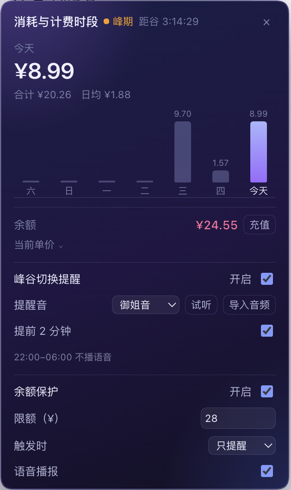

<p align="center">
  
</p>

<h1 align="center">消耗峰谷图 · dsh-spend-trend</h1>

<p align="center"><b>峰时把思路理清楚，谷时把重活狠狠干 —— 让每一分钱都花在刀刃上。</b></p>

<p align="center">
  <a href="README.en.md">English</a> ·
  <a href="https://www.npmjs.com/package/@apecube/dsh-spend-trend"></a>
  
</p>

## 为什么装它

- 💰 **错峰省钱是核心**：同一次生成，谷时价格只有峰时的一半——输出 ¥8 → ¥4/百万 tokens，缓存命中 ¥0.04 → ¥0.02。插件把“现在贵不贵、还有多久变便宜”变成随时可见的一行字。
- ⏰ **提醒是为了踩准便宜窗口**：谷时一到，语音喊你开工——那是长任务、批量生成、重构的最佳时段；峰时就用轻活填（整理需求、写提示词、改文案、review）。声音难听不难听不重要，重要的是**别把重活干在贵的时候**。
- 📊 **账单一目了然**：账户余额、今日花费、近 7 天柱状图、当前模型单价（峰/谷两档），点一下全都有。
- 🪶 **轻、纯本地**：纯 JavaScript、零运行时依赖、不访问外网，只在本机读会话日志里的 token 用量。
- 🪟 **只占一行，不挡视线**：13 寸小屏也放得下；侧边栏收起后只剩一个小圆点和金额，不抢你任何工作区。

## 安装

**DSH 桌面端**：左侧 **插件 → Add plugin**，输入包名

```
@apecube/dsh-spend-trend
```

点 **Install**，装完 **Enable now** 并刷新页面即可。

**普通 `dsh web` profile**：

```sh
dsh plugin --profile <profile> add @apecube/dsh-spend-trend
```

也可以直接从 GitHub 安装：

```sh
dsh plugin --profile <profile> add github:wlerry/dsh-spend-trend
```

卸载：`dsh plugin --profile <profile> remove @apecube/dsh-spend-trend`

## 截图




## 怎么用：错峰工作法

| 时段 | 适合干什么 | 为什么 |
|---|---|---|
| **峰时**（工作日 09:00–12:00、14:00–18:00） | 捋需求、写提示词、看方案、改文案、code review | 交互多、token 少，贵一点不心疼 |
| **谷时**（其余时段 + 周末） | 跑长任务、批量生成、重构、长文档、多轮 Agent | 单价减半，同样预算能干两倍的活 |
| **睡前** | 把重活排到 0 点之后跑 | 整夜都是谷时 |

一句话：**贵的时段用来想，便宜的时段用来干**。

## 它显示什么

侧边栏底部、账户入口正上方的一个徽标：

- **当前计费时段**：`● 峰期` / `● 谷期`，后面是距下一次切换的倒计时，最右是**账户余额**；
- 点击弹出面板：**近 7 天花费（人民币）柱状图**、当前模型单价、今日花费、合计/日均、余额构成、峰谷时段表。

## 峰谷提醒

面板底部可以开启切换提醒（默认关闭）：

| 设置 | 说明 |
|---|---|
| 开启提醒 | 总开关；首次开启时请求系统通知权限，拒绝则只响铃 |
| 提醒音 | 御姐音 / 萝莉音 / Ping / Chime / Bell / 静音，可试听；放在 `~/.dsh/spend-trend-sounds/` 的自定义音频也会出现在这里 |
| 提前 2 分钟 | 默认关；开启后在切换前 2 分钟播一声轻提示 |

规则：**切到谷期**播你选的语音，**切到峰期**一律用 Ping；北京时间 **22:00–06:00 不播语音**，自动降级为 Ping。设置存在浏览器 `localStorage`（按设备生效）；页面需要开着才会响，系统睡眠期间不会响，醒来后会补一次。

## 自定义提醒音

内置的两段语音不一定合每个人口味，你可以放自己的音频进去：

```sh
# 目录：$DSH_HOME/spend-trend-sounds/（默认 ~/.dsh/spend-trend-sounds/）
mkdir -p ~/.dsh/spend-trend-sounds
cp 我的提示音.mp3 ~/.dsh/spend-trend-sounds/
```

- 支持 **mp3 / m4a / wav / ogg**，单个文件 ≤ 4 MB；
- 文件名就是下拉菜单里的选项名（`我的提示音.mp3` 显示为 `我的提示音`）；
- 打开面板时会重新扫描，不用重启；文件删掉后会自动回落到默认语音；
- 只读取这个目录、只认单层文件名，隐藏文件和 `../` 这类路径会被拒绝。

## 计费口径

DeepSeek 自 2026-08-17 起实行峰谷分时定价，本插件按**每次调用实际发生时刻**的档位计价（不是按天、也不是按当前时刻）：

| 模型 | 缓存命中（谷/峰） | 缓存未命中（谷/峰） | 输出（谷/峰） |
|---|---|---|---|
| deepseek-flash | ¥0.02 / ¥0.04 | ¥1 / ¥2 | ¥4 / ¥8 |
| deepseek-v4-pro | ¥0.15 / ¥0.30 | ¥4.5 / ¥9 | ¥13.5 / ¥27 |

单位：元 / 百万 tokens（[官方价目表](https://api-docs.deepseek.com/zh-cn/quick_start/pricing/)）。

- 高峰：**北京时间周一至周五 09:00–12:00、14:00–18:00**；其余时段、周末全天为谷时。
- 成本 = 未命中 × 未命中价 + （缓存读 + 缓存写）× 命中价 + 输出 × 输出价，价格取自该条 usage 发生时刻的档位。
- 未知模型按 deepseek-flash 计费。
- **中国法定节假日**默认不内置，通过 `$DSH_HOME/spend-trend-holidays.json` 配置（见下）。

### 一次重构要花多少钱

假设一个中型重构跑 **100 轮**调用，每轮输入 12 万 tokens（其中 10 万缓存命中、2 万未命中），输出 4 千 tokens，用 `deepseek-flash`：

| 项目 | 每轮（峰时） | 每轮（谷时） |
|---|---|---|
| 未命中 2 万 × 单价 | 2 万 × ¥2/M = ¥0.040 | 2 万 × ¥1/M = ¥0.020 |
| 命中 10 万 × 单价 | 10 万 × ¥0.04/M = ¥0.004 | 10 万 × ¥0.02/M = ¥0.002 |
| 输出 4 千 × 单价 | 4 千 × ¥8/M = ¥0.032 | 4 千 × ¥4/M = ¥0.016 |
| **合计** | **¥0.076** | **¥0.038** |

整个任务：**峰时 ¥7.60，谷时 ¥3.80**；一个月跑 20 次，就是 **¥152 vs ¥76**，省下来的 ¥76 等于白得 20 次重构。

> 数字按官方价目表和上述 token 结构估算；实际花费取决于缓存命中率——命中率越高，峰谷差价越集中在“命中价”那一档（¥0.04 vs ¥0.02）。

## 平台支持

macOS、Windows、Linux 都能用：插件是纯 JavaScript，主机侧只用到 Node 的跨平台 API（`fs` / `os` / `path`），浏览器侧是普通 Web 组件，不含任何 shell 命令、原生依赖或平台判断。CI 在 Ubuntu、Windows、macOS 三个平台 × Node 20/22/24 上跑测试。

## 法定节假日

官方口径里，中国法定节假日全天按谷时计价。默认没有内置节假日表（节假日前后的调休、调价都可能变），可以放一个文件让判定跟上：

```sh
# 路径：$DSH_HOME/spend-trend-holidays.json（默认 ~/.dsh/spend-trend-holidays.json）
["2026-10-01", "2026-10-02", "2026-10-03"]
```

文件不存在或格式不对时按“无节假日”处理，不影响启动。

## 数据来源

- **花费**：主机侧读取会话持久化日志，取 `assistant/message` 里模型上报的 `usage`，按事件时刻的峰谷档位折算成人民币，按 15 分钟切片归并成 7 天窗口。
- **余额**：复用账户插件的 `account.getBalance` 远端调用（充值 + 赠送合计）。
- **语音**：`assets/sounds/` 下的两个音频包由主机侧只读路由提供，只在本机播放，不上传。

## 刷新方式

| 内容 | 方式 | 频率 |
|---|---|---|
| 花费 / 时段档位 | 轮询 `GET /plugin/dsh-spend-trend/daily` | 每 60 秒 |
| 余额 | 远端调用 `account.getBalance` | 每 180 秒 |
| 倒计时 | 纯本地计时 | 每秒，不发请求 |

页面切到后台时不额外请求，切回可见时补一次；倒计时归零（峰谷切换）时会立刻补拉一次，不等下一个 60 秒。

## 文件

| 文件 | 作用 |
|---|---|
| `index.js` | 插件入口：路由装配、节假日文件加载、语音路由 |
| `lib/pricing.js` | 价目表、峰谷判定与按时刻计价 |
| `lib/usage.js` | 会话日志聚合 |
| `client.js` | 浏览器侧：`sidebar.footer.action` 槽位里的徽标、面板与提醒设置 |
| `cordis.patch.yml` | 插入 `spend-trend` 插件行 |
| `locale/*.json` | 插件管理器中的标题与描述 |
| `icon.svg` | 插件列表图标（矢量） |
| `assets/icon-180.png` | 插件市场卡片用的 180×180 位图 |
| `assets/icon-source.png` | 图标设计原稿（1254×1254，不进 npm 包） |
| `assets/screenshots/*.png` | 市场详情页截图 |
| `assets/sounds/*.m4a` | 峰谷提醒语音（御姐音 / 萝莉音） |
| `screenshots.json` | 声明市场展示的截图顺序（市场从仓库读取） |

## 开发

```sh
node --test test/     # 17 个用例：峰谷边界、周末/节假日、两档计价、日窗口聚合、revision 缓存、提醒规则
```

代码分层：

| 文件 | 职责 |
|---|---|
| `lib/pricing.js` | 价目表、北京时间峰谷判定、按调用时刻计价（纯函数，无 I/O） |
| `lib/usage.js` | 会话日志折叠成 15 分钟桶、7 天窗口聚合 |
| `index.js` | 插件入口与路由装配 |
| `client.js` | 浏览器 bundle（手写，无需构建） |
| `test/` | 纯函数、聚合与提醒规则的单测 |

CI 在 Ubuntu / Windows / macOS × Node 20/22/24 上跑语法检查、测试和 manifest 检查。

## 已知限制

- 价格表内置在 `lib/pricing.js`，官方调价后需同步更新（展示与计费共用同一份常量）。
- 只统计已持久化的会话日志，进程内最后一批事件可能有几十毫秒延迟。
- 路由只监听本机回环地址、不带鉴权，只暴露汇总数字，不含会话内容。
- 提醒依赖页面存活：DSH 窗口关掉后不会响。
